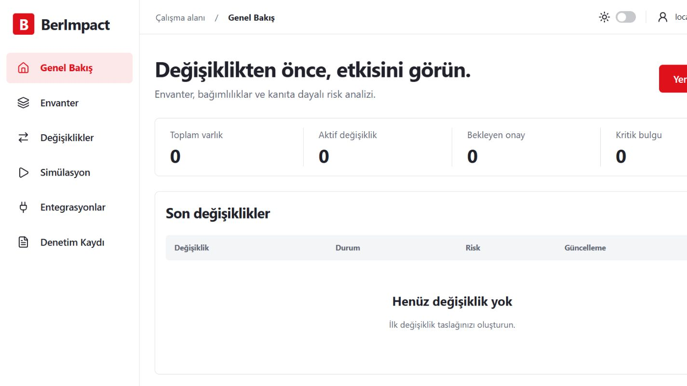
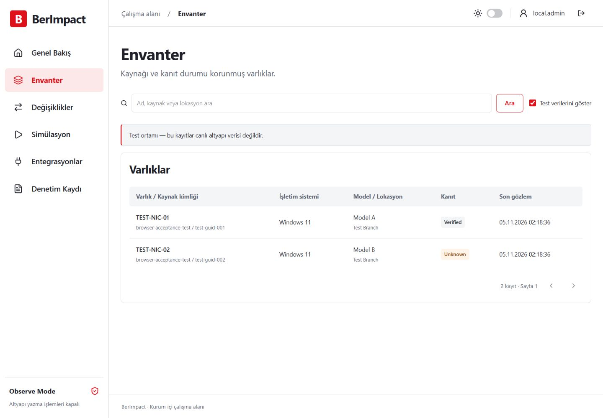
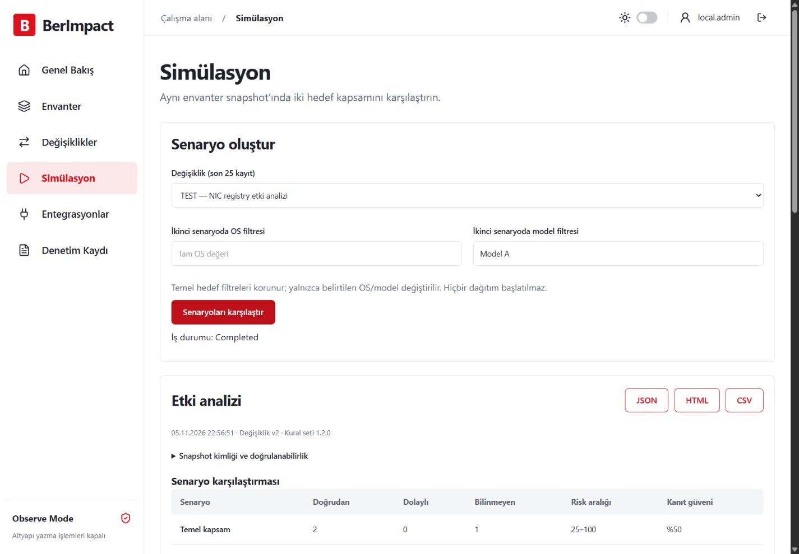

<h1 align="center">BerImpact</h1>

<b>Değişiklikten önce, etkisini görün.</b> Kurum içi etki analizi · Açıklanabilir risk · Senaryo karşılaştırması

<a href="https://github.com/BerkayAtag/BerImpact/releases/tag/v0.1.1"><b>0.1.1 ön sürümünü indir</b></a> · <a href="https://berkayatag.github.io/BerImpact/">Tanıtım</a> · <a href="docs/DEPLOYMENT.md">Kurulum</a> · <a href="docs/CHANGELOG.md">Sürüm notları</a>

<picture><source media="(prefers-color-scheme: dark)" srcset="site/assets/dashboard-dark.png"></picture>

Envanteri içe aktarın, değişiklik taslağını oluşturun ve etkiyi analiz edin. Alternatif kapsamları aynı snapshot üzerinde karşılaştırın; pilot önerisini ve raporları alın. **Veriler kendi ortamınızda kalır.**

- **Envanter:** kaynak kimliği, kanıt durumu, güncellik ve test/canlı ayrımı.
- **Analiz:** doğrudan/dolaylı etkiler, bağımlılık yolları, açıklanabilir risk aralığı.
- **Karar:** sürümlü taslak, görev ayrılığı, kanıt kapıları ve değiştirilemez denetim kaydı.
- **Rapor:** HTML, CSV ve JSON. Bulut servisi veya endpoint ajanı zorunlu değil.

| Envanter | Senaryo karşılaştırması |
|---|---|
|  |  |

Ekranlar gerçek uygulamadan alınmıştır; gösterilen envanter sentetik test verisidir.

**Kurulum:** [Release](https://github.com/BerkayAtag/BerImpact/releases/tag/v0.1.1) paketini ve SHA-256 dosyasını indirin. [Linux / Docker](docs/DEPLOYMENT.md) · [Windows](docs/WINDOWS_INSTALLATION.md) · [Offline](docs/OFFLINE_INSTALLATION.md)

**Sınırlar:** Geliştirme ön sürümü, yalnız **Observe Mode**. Altyapıya değişiklik uygulamaz. AD/GPO/SCCM/BigFix, tarihsel sonuç toplama ve HA henüz tamamlanmadı; Windows servis kabul testi bekliyor.

[Doğrulama](docs/TESTING.md) · [Geliştirme](docs/DEVELOPMENT.md) · [Mimari](docs/ARCHITECTURE.md) · [Güvenlik](docs/SECURITY.md) · [Yol haritası](docs/ROADMAP.md)

© 2026 Berkay Atağ
