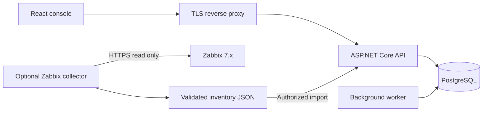
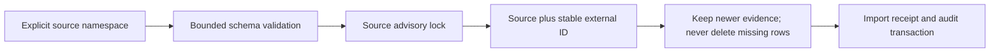
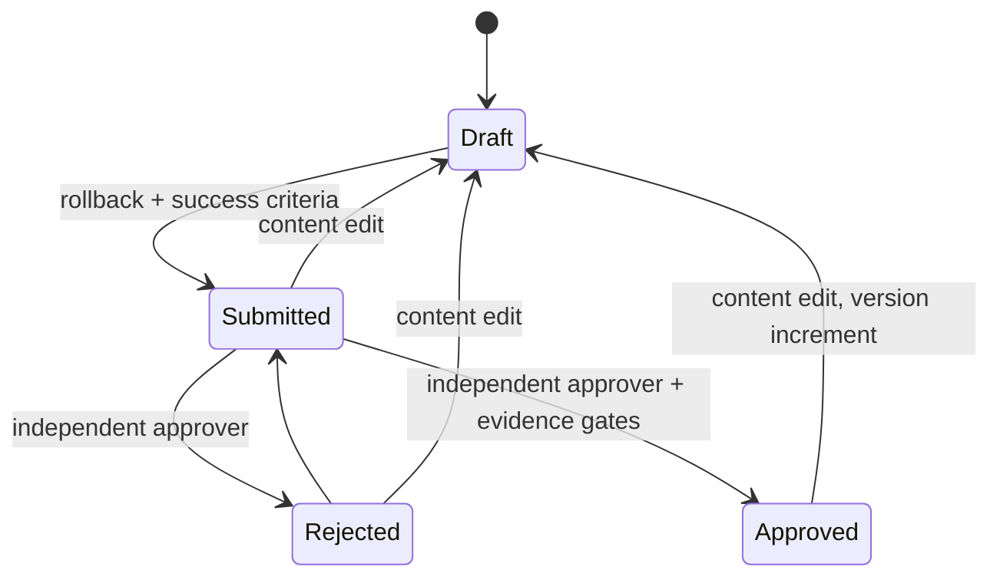
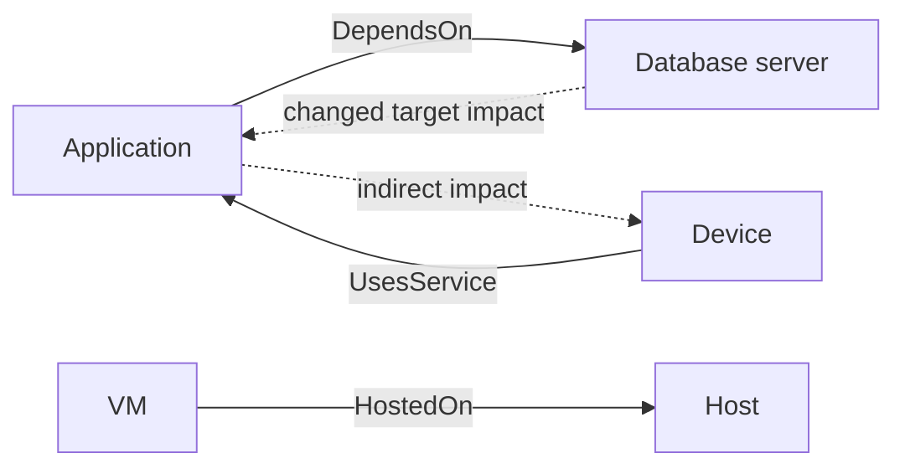
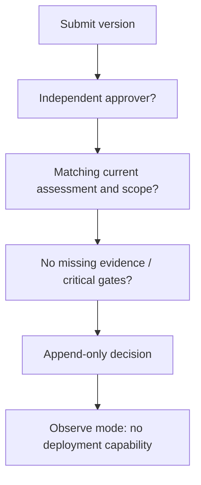

# Architecture — implemented vs planned

The modular monolith has Domain (entities), Application (pure risk/target/dependency/governance), SDK (read-only connector contracts), Infrastructure (EF/Identity/jobs), API (versioned endpoints), Workers (standalone service), Connectors and collector CLI. React assets are bundled into the API in release images. PostgreSQL is the only required data service.

Approved is a supported domain state but current history/coverage gaps prevent passing the API approval gate. Scheduled/executing/paused/completed states and infrastructure orchestration are planned, not simulated.

```mermaid
flowchart LR
  Change[Versioned change] --> Job[Bounded durable job]
  Job --> Snapshot[Repeatable-read inventory snapshot]
  Snapshot --> Targets[Attribute / explicit ID target filter]
  Targets --> Graph[Reverse dependency traversal]
  Graph --> Factors[Five weighted factors]
  Factors --> Unknown[Unknown factors preserve uncertainty]
  Unknown --> Result[Range + findings + confidence + pilot]
  Result --> Evidence[Append-only assessment + snapshot hash]
```

Edges point from dependent to dependency; analysis traverses the reverse adjacency. Cycles are visited once. Depth limit produces a finding. Global snapshot limits reject oversized input. This is not a 100k-asset certified graph implementation.

Ten module boundaries from the master spec are retained in ROADMAP: Discovery, Change, Target, Dependency, Risk, Simulation, Pilot, Governance, Deployment Guard, Outcome. The latter two have no executable infrastructure operations. No arbitrary DLL plugins, cloud endpoints or AI dependency are introduced.
