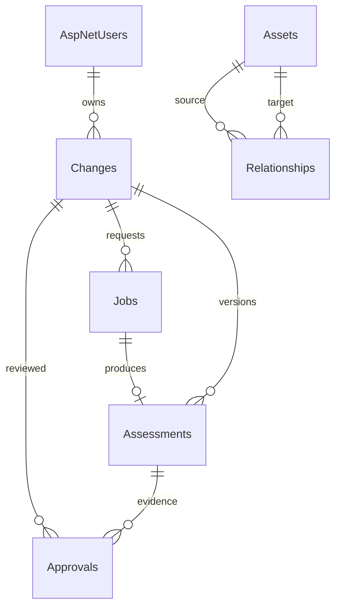

# Database schema

EF Core migrations in `src/backend/Infrastructure/Migrations` are authoritative. UTC timestamps map to timestamptz. JSONB stores configurations and immutable analysis payloads; queryable inventory and relationships remain relational.

| Table | Purpose and constraints |
|---|---|
| AspNetUsers / Roles / UserRoles / Claims / Logins / Tokens | ASP.NET Identity, role membership, normalized names, salted hashes, lockout |
| Assets | UUID; unique Source + ExternalId; test/live, evidence, last observation; PostgreSQL xmin concurrency |
| Relationships | UUID; two restrictive asset FKs; unique source/target/type/provenance; reverse-target index |
| Changes | UUID; owner FK; version, xmin, state, configuration JSON, target JSON, test flag |
| Jobs | UUID; change FK and version pinned at queue time; unique requester + idempotency key; request hash, status, lease, retry count |
| Assessments | UUID; unique job FK; change FK/version, ruleset, snapshot, SHA-256, results; append-only |
| Approvals | UUID; change and assessment FKs; unique change/version/actor; append-only |
| Imports | UUID; unique source/idempotency key; content hash, count, completion time, data class |
| Audit | bigint sequence; timestamp index; actor, action, entity, detail, correlation ID; append-only |

Audit, assessment and approval mutations are blocked by EF and PostgreSQL statement triggers (including TRUNCATE). Runtime credentials are not table owners in production Compose; superusers can still override controls and require separate operational auditing.

Snapshot hash is SHA-256 of canonical application serialization (`Json.Write(Json.Read<AnalysisInput>(SnapshotJson))`), not the raw PostgreSQL JSONB text. JSONB can reorder properties. Replay must use the recorded ruleset implementation; upgrades must preserve old evaluators before changing the ruleset version.

Current ruleset is 1.2.0; the evaluator also accepts 1.0.0 and 1.1.0 explicitly. The current integration test replays using the stored version. Interim development snapshots are not certified historical records. A queued job fails if its change version has changed before execution, and snapshots contain only the change's test/live partition. Pre-migration jobs default to version zero and fail safely instead of analyzing a newer draft silently.

No automated retention/deletion or partitioning is implemented. Do not silently purge evidence. Partition and retention work is gated on measured volume, retention requirements and archive validation. All production inventory tables start empty.
